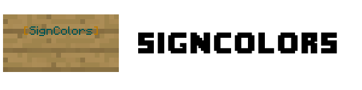

# Introduction

SignColors is a Spigot plugin that lets players with the appropriate permissions add colors and formatting to signs. Write the configurable prefix (default `&`) followed by a color or formatting code, such as `&a` or `&l`.

## Features

- Players can add colors/formats to regular and hanging signs.
- Permissions per color/format.
- Use your own color symbol instead of `&`.
- Possibility to craft colored signs (recipe and type are configurable).
- Optional crafted-sign requirement; players can also obtain colored signs from `[SC]` buy signs or a command.
- Buy signs require [Vault](https://www.spigotmc.org/resources/vault.34315/) and a compatible economy provider.
- Colored sign identity is stored in Minecraft item and block data; marked signs retain their identity when dropped through normal block drops.
- Configurable blocked first lines can help prevent imitation of special signs.
- Automatically checks for updates (configurable).
- English and German translations are included; additional languages can be added manually.
