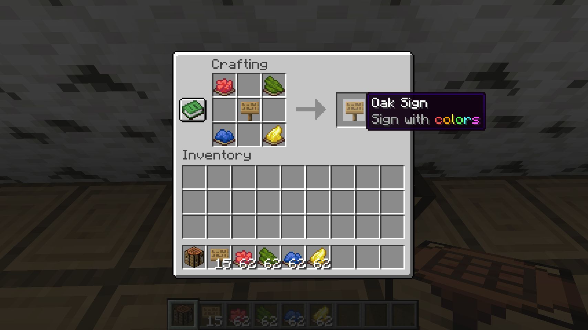
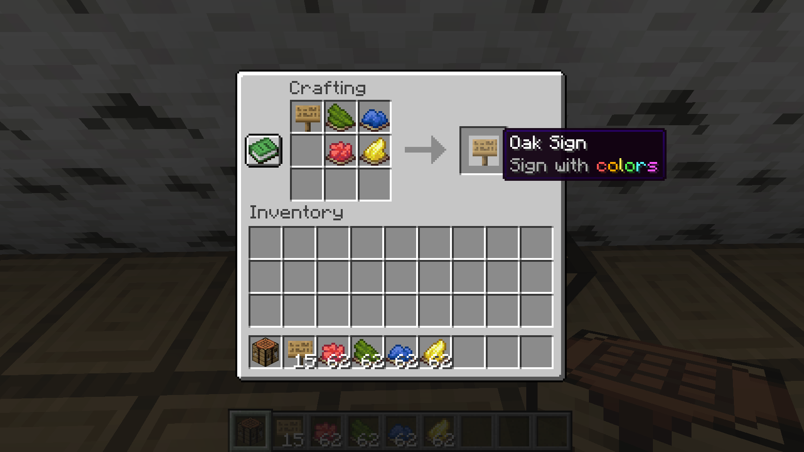
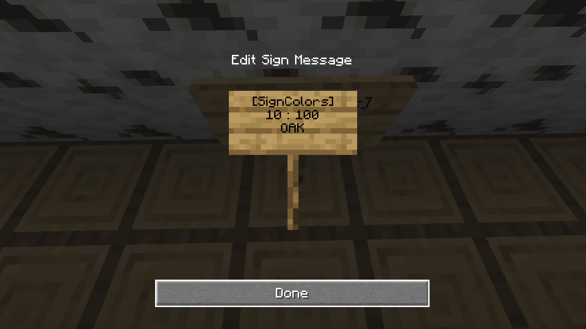
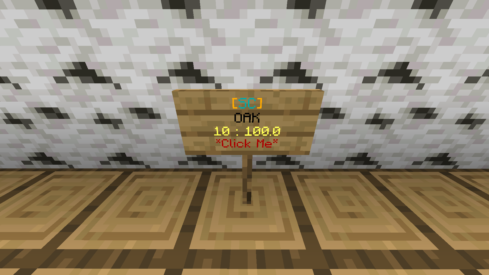
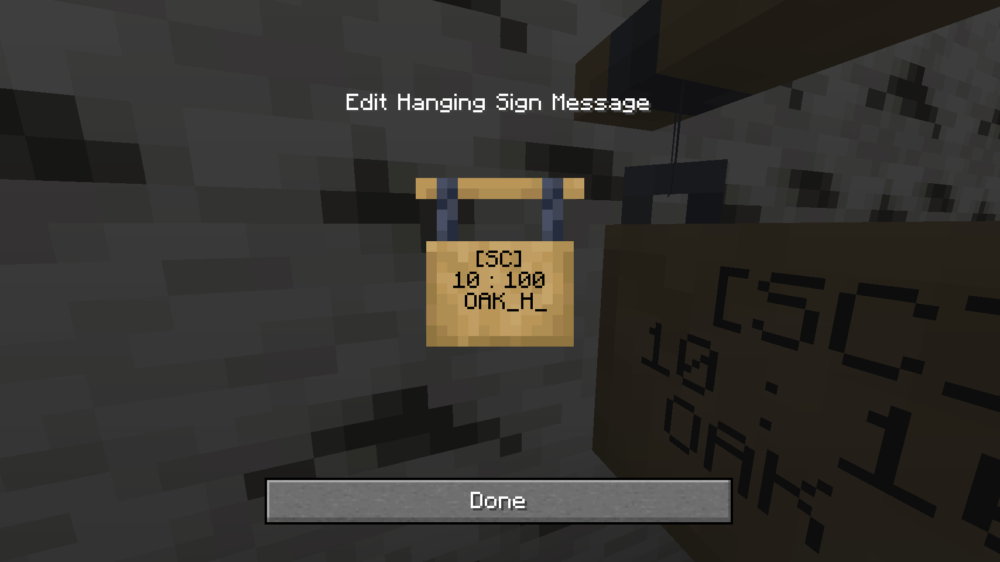
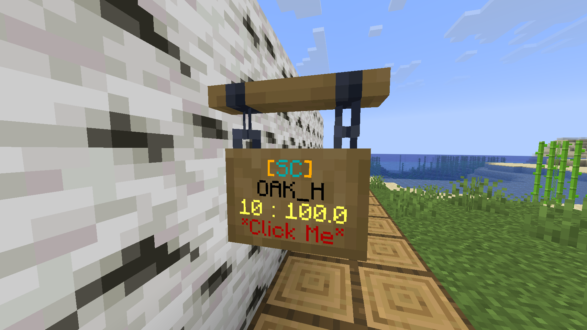

# Usage

## Adding colors and formatting

Write the configured prefix (default `&`) followed by a code before the text, for example `&aHello &lworld`. You can use multiple codes per line. See [Permissions](permissions.md) for the available codes and their permission nodes, or use `/sc codes` to display them in game.

When `crafting.enabled` is `true` (the default), use a colored sign obtained from the recipe, a buy sign, or `/sc givesign`. Players with `signcolors.bypass.crafting` can use ordinary signs. When crafting is disabled, ordinary signs work for everyone who has the relevant color or formatting permissions.

When editing a sign that meets the crafting requirement, existing legacy color and formatting codes are shown using the configured prefix, including codes you cannot apply. On save, codes without permission remain visible as literal text. Codes are reconstructed from the sign's formatting, so they may not exactly match the original input. Signs with hex colors are not converted to editable codes. Visible codes take up space, so long lines may need shortening. Disable this feature with `other.editableSignColors`.

## Crafting a colored sign

By default, craft a colored sign using one sign and one each of red, green, blue, and yellow dye. Place the sign in the center of a crafting table, with red and green dye in the top corners and blue and yellow dye in the bottom corners:

If the server is configured to use a **shapeless** recipe with the same ingredients, place them anywhere in the crafting grid instead:

The server's configured recipe determines the ingredients, arrangement, and output amount. With the default `ANY_SIGN` ingredient, regular and hanging signs are supported and the result matches the input sign type. See [Crafting configuration](configuration.md#crafting) for details. You still need the relevant [permissions](permissions.md) to apply colors and formatting.

## Creating a buy sign

A player with `signcolors.buysign.create` can create a sign with these lines:

| Line | Content |
| --- | --- |
| 1 | `[SignColors]` or `[SC]` (use `[SC]` on hanging signs) |
| 2 | Optional: `<amount>:<price>`, for example `10:100.0` |
| 3 | Optional: sign type, for example `OAK` or `OAK_H` for a hanging sign |
| 4 | Ignored; the plugin fills this line. |

Leave line 2 or 3 blank to use its configured default. Spaces around the colon on line 2 are optional: `10:100` and `10 : 100` are equivalent. The amount must be a positive integer, and the price must be positive and finite. For a hanging sign, append `_H` to the wood type (for example, `OAK_H` or `DARK_OAK_H`). Full material names such as `OAK_HANGING_SIGN`, or names without `_SIGN` such as `OAK_HANGING`, are also accepted if they fit. Existing buy signs with full material names continue to work. The plugin formats and waxes the completed sign.

### Standing sign example

This example sells 10 regular oak signs for 100. Enter `[SignColors]`, `10:100`, and `OAK` on the first three lines:

After creation, the plugin displays the sign type, amount, and price:

### Hanging sign example

Use the shorter `[SC]` header on a hanging sign. This example sells 10 oak hanging signs for 100 using `OAK_H`:

Players with `signcolors.buysign.use` can right-click it to buy colored signs. Purchases require Vault and a compatible economy provider. The configured amount, price, and material can differ from the examples above.
