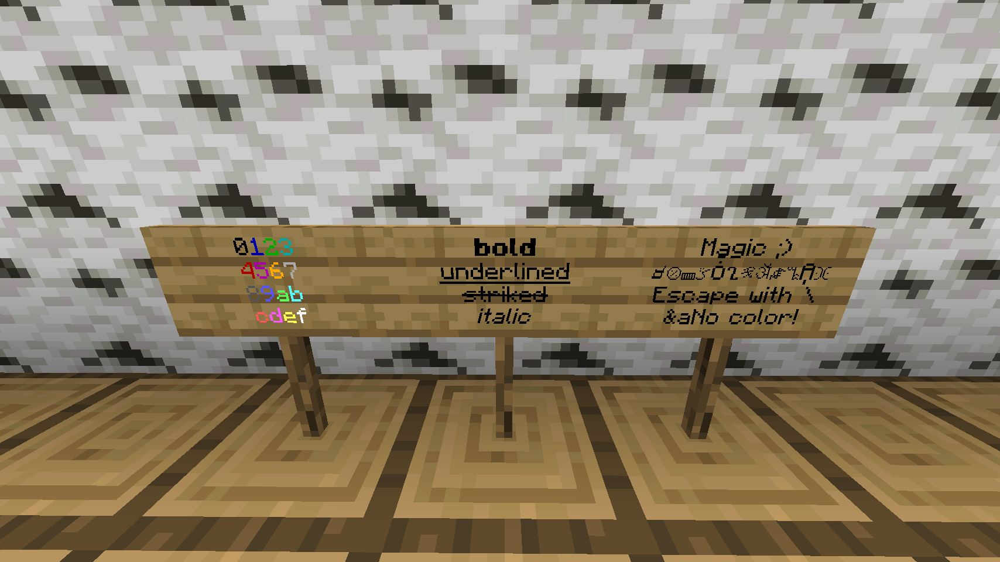
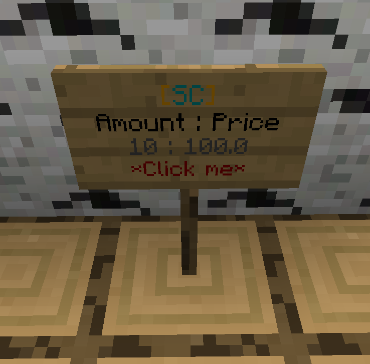

# Usage

## Adding colors and formatting

Write the configured prefix (default `&`) followed by a code before the text, for example `&aHello &lworld`. You can use multiple codes per line. See [Permissions](permissions.md) for the available codes and their permission nodes, or use `/sc codes` to display them in game.

When `crafting.enabled` is `true` (the default), use a colored sign obtained from the recipe, a buy sign, or `/sc givesign`. Players with `signcolors.bypass.crafting` can use ordinary signs. When crafting is disabled, ordinary signs work for everyone who has the relevant color or formatting permissions.

When editing a sign that meets the crafting requirement, existing legacy color and formatting codes are shown using the configured prefix, including codes you cannot apply. On save, codes without permission remain visible as literal text. Codes are reconstructed from the sign's formatting, so they may not exactly match the original input. Signs with hex colors are not converted to editable codes. Visible codes take up space, so long lines may need shortening. Disable this feature with `other.editableSignColors`.

## Creating a buy sign

A player with `signcolors.buysign.create` can create a sign with these lines:

| Line | Content |
| --- | --- |
| 1 | `[SignColors]` |
| 2 | Optional: `<amount>:<price>`, for example `10:100.0` |
| 3 | Optional: supported sign material, for example `OAK_SIGN` |
| 4 | Ignored; the plugin fills this line. |

Leave line 2 or 3 blank to use its configured default. The amount must be a positive integer, and the price must be positive and finite. The plugin formats and waxes the completed sign.

Players with `signcolors.buysign.use` can right-click it to buy colored signs. Purchases require Vault and a compatible economy provider. The configured amount, price, and material can differ from the examples above.
